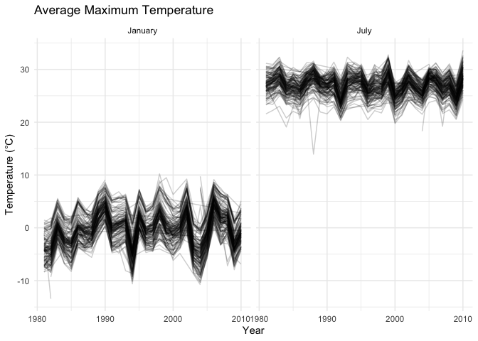
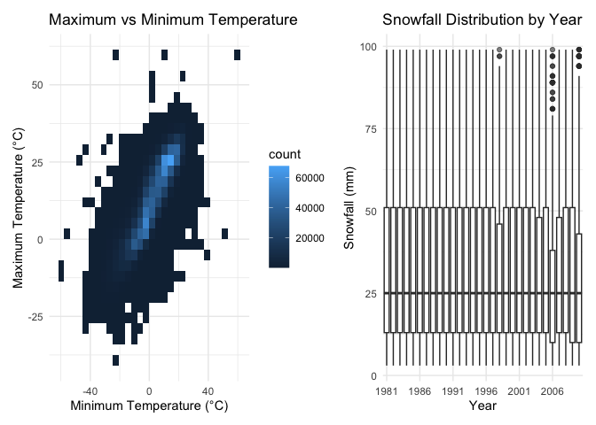
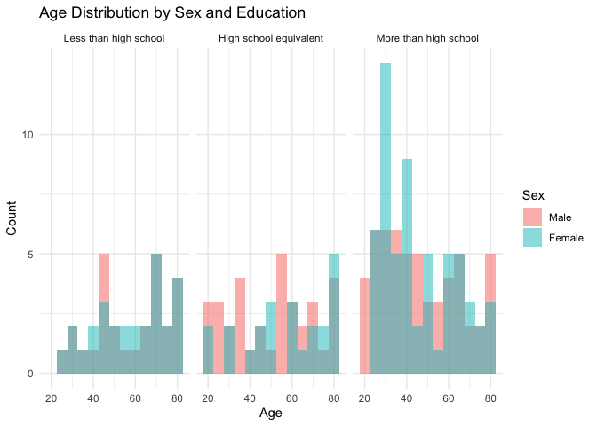
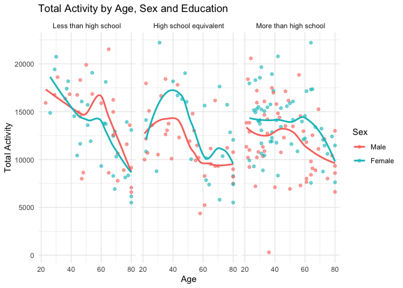
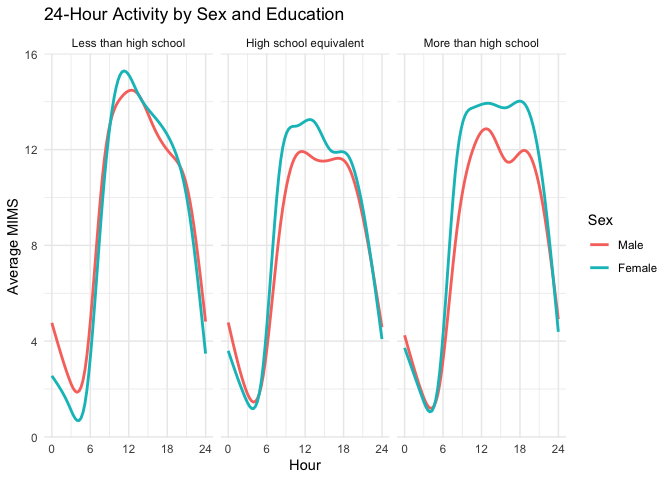
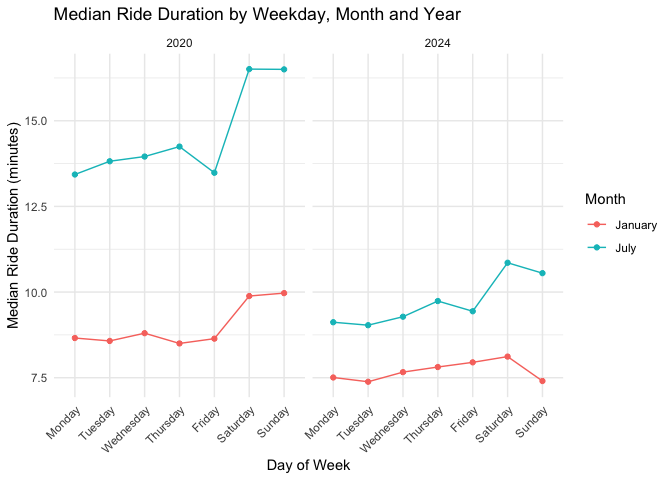
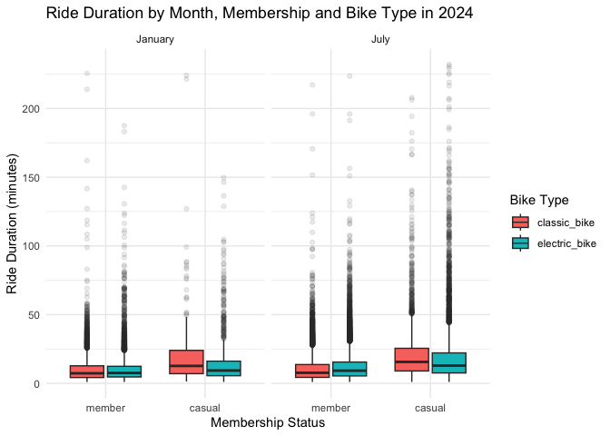

Homework 3
================
Jinghao Zhang

# Problem 1

``` r
library(tidyverse)
library(p8105.datasets)
library(patchwork)
```

``` r
data("ny_noaa")

data1 = ny_noaa

dim(data1)
```

    ## [1] 2595176       7

``` r
names(data1)
```

    ## [1] "id"   "date" "prcp" "snow" "snwd" "tmax" "tmin"

``` r
head(data1)
```

    ## # A tibble: 6 × 7
    ##   id          date        prcp  snow  snwd tmax  tmin 
    ##   <chr>       <date>     <int> <int> <int> <chr> <chr>
    ## 1 US1NYAB0001 2007-11-01    NA    NA    NA <NA>  <NA> 
    ## 2 US1NYAB0001 2007-11-02    NA    NA    NA <NA>  <NA> 
    ## 3 US1NYAB0001 2007-11-03    NA    NA    NA <NA>  <NA> 
    ## 4 US1NYAB0001 2007-11-04    NA    NA    NA <NA>  <NA> 
    ## 5 US1NYAB0001 2007-11-05    NA    NA    NA <NA>  <NA> 
    ## 6 US1NYAB0001 2007-11-06    NA    NA    NA <NA>  <NA>

``` r
summary(data1)
```

    ##          id               date                 prcp         
    ##  Length   :2595176   Min.   :1981-01-01   Min.   :    0.00  
    ##  N.unique :    747   1st Qu.:1988-11-29   1st Qu.:    0.00  
    ##  N.blank  :      0   Median :1997-01-21   Median :    0.00  
    ##  Min.nchar:     11   Mean   :1997-01-01   Mean   :   29.82  
    ##  Max.nchar:     11   3rd Qu.:2005-09-01   3rd Qu.:   23.00  
    ##                      Max.   :2010-12-31   Max.   :22860.00  
    ##                                           NAs    :145838    
    ##       snow                snwd                tmax                tmin        
    ##  Min.   :  -13.000   Min.   :   0.00   Length   :2595176   Length   :2595176  
    ##  1st Qu.:    0.000   1st Qu.:   0.00   N.unique :    532   N.unique :    548  
    ##  Median :    0.000   Median :   0.00   N.blank  :      0   N.blank  :      0  
    ##  Mean   :    4.987   Mean   :  37.31   Min.nchar:      1   Min.nchar:      1  
    ##  3rd Qu.:    0.000   3rd Qu.:   0.00   Max.nchar:      4   Max.nchar:      4  
    ##  Max.   :10160.000   Max.   :9195.00   NAs      :1134358   NAs      :1134420  
    ##  NAs    :381221      NAs    :591786

The dataset contains 2595176 observations and 7 variables from 747
weather stations between 1981 and 2010. The variables include
precipitation, snowfall, snow depth, maximum temperature, and minimum
temperature. Each row has observations at one station on a specific
date. There are many missing values, especially for temperature.

``` r
data2 = data1 |>
  mutate(
    year = lubridate::year(date),
    month = lubridate::month(date),
    day = lubridate::day(date),
    tmax = as.numeric(tmax) / 10,
    tmin = as.numeric(tmin) / 10,
    prcp = prcp / 10
  )

head(data2)
```

    ## # A tibble: 6 × 10
    ##   id          date        prcp  snow  snwd  tmax  tmin  year month   day
    ##   <chr>       <date>     <dbl> <int> <int> <dbl> <dbl> <dbl> <dbl> <int>
    ## 1 US1NYAB0001 2007-11-01    NA    NA    NA    NA    NA  2007    11     1
    ## 2 US1NYAB0001 2007-11-02    NA    NA    NA    NA    NA  2007    11     2
    ## 3 US1NYAB0001 2007-11-03    NA    NA    NA    NA    NA  2007    11     3
    ## 4 US1NYAB0001 2007-11-04    NA    NA    NA    NA    NA  2007    11     4
    ## 5 US1NYAB0001 2007-11-05    NA    NA    NA    NA    NA  2007    11     5
    ## 6 US1NYAB0001 2007-11-06    NA    NA    NA    NA    NA  2007    11     6

``` r
summary(data2)
```

    ##          id               date                 prcp         
    ##  Length   :2595176   Min.   :1981-01-01   Min.   :   0.000  
    ##  N.unique :    747   1st Qu.:1988-11-29   1st Qu.:   0.000  
    ##  N.blank  :      0   Median :1997-01-21   Median :   0.000  
    ##  Min.nchar:     11   Mean   :1997-01-01   Mean   :   2.982  
    ##  Max.nchar:     11   3rd Qu.:2005-09-01   3rd Qu.:   2.300  
    ##                      Max.   :2010-12-31   Max.   :2286.000  
    ##                                           NAs    :145838    
    ##       snow                snwd              tmax              tmin        
    ##  Min.   :  -13.000   Min.   :   0.00   Min.   :-38.90    Min.   :-59.400  
    ##  1st Qu.:    0.000   1st Qu.:   0.00   1st Qu.:  5.00    1st Qu.: -3.900  
    ##  Median :    0.000   Median :   0.00   Median : 15.00    Median :  3.300  
    ##  Mean   :    4.987   Mean   :  37.31   Mean   : 13.98    Mean   :  3.029  
    ##  3rd Qu.:    0.000   3rd Qu.:   0.00   3rd Qu.: 23.30    3rd Qu.: 11.100  
    ##  Max.   :10160.000   Max.   :9195.00   Max.   : 60.00    Max.   : 60.000  
    ##  NAs    :381221      NAs    :591786    NAs    :1134358   NAs    :1134420  
    ##       year          month             day       
    ##  Min.   :1981   Min.   : 1.000   Min.   : 1.00  
    ##  1st Qu.:1988   1st Qu.: 4.000   1st Qu.: 8.00  
    ##  Median :1997   Median : 7.000   Median :16.00  
    ##  Mean   :1996   Mean   : 6.565   Mean   :15.73  
    ##  3rd Qu.:2005   3rd Qu.:10.000   3rd Qu.:23.00  
    ##  Max.   :2010   Max.   :12.000   Max.   :31.00  
    ## 

``` r
data2 |>
  count(snow, sort = TRUE) |>
  head(10)
```

    ## # A tibble: 10 × 2
    ##     snow       n
    ##    <int>   <int>
    ##  1     0 2008508
    ##  2    NA  381221
    ##  3    25   31022
    ##  4    13   23095
    ##  5    51   18274
    ##  6    76   10173
    ##  7     8    9962
    ##  8     5    9748
    ##  9    38    9197
    ## 10     3    8790

The most commonly observed value is 0. Maybe because most days did not
have snow.

``` r
data3 = data2 |>
  filter(month == 1 | month == 7) |>
  group_by(id, year, month) |>
  summarize(
    avg_temp = mean(tmax, na.rm = TRUE),
    .groups = "drop"
  ) |>
  filter(!is.nan(avg_temp))

plot1 = data3 |>
  ggplot(aes(x = year, y = avg_temp, group = id)) +
  geom_line(alpha = 0.2) +
  facet_wrap(~month, ncol = 2,
             labeller = as_labeller(c("1" = "January",
                                     "7" = "July"))) +
  labs(
    title = "Average Maximum Temperature",
    x = "Year",
    y = "Temperature (°C)"
  ) +
  theme_minimal()

plot1
```

<!-- -->

The average max temperature in January is lower than July. January
temperatures are mostly around -10 to 10 degrees. July temperatures are
mostly around 20 to 35 degrees. There are a few outliers.

``` r
plot2 = data2 |>
  filter(!is.na(tmax), !is.na(tmin)) |>
  ggplot(aes(x = tmin, y = tmax)) +
  geom_bin2d() +
  labs(
    title = "Maximum vs Minimum Temperature",
    x = "Minimum Temperature (°C)",
    y = "Maximum Temperature (°C)"
  ) +
  theme_minimal()


plot3 = data2 |>
  filter(snow > 0, snow < 100) |>
  ggplot(aes(x = factor(year), y = snow)) +
  geom_boxplot(outlier.alpha = 0.2) +
  scale_x_discrete(
    breaks = as.character(seq(1981, 2010, 5))
  ) +
  labs(
    title = "Snowfall Distribution by Year",
    x = "Year",
    y = "Snowfall (mm)"
  ) +
  theme_minimal()


plot2 + plot3
```

<!-- -->

# Problem 2

``` r
data4 = read_csv("https://p8105.com/data/nhanes_covar.csv")

data5 = read_csv("https://p8105.com/data/nhanes_accel.csv")

dim(data4)
```

    ## [1] 254   5

``` r
dim(data5)
```

    ## [1]  250 1441

``` r
head(data4)
```

    ## # A tibble: 6 × 5
    ##   ...1  `1 = male` ...3  ...4  `1 = Less than high school`
    ##   <chr> <chr>      <chr> <chr> <chr>                      
    ## 1 <NA>  2 = female <NA>  <NA>  2 =  High school equivalent
    ## 2 <NA>  <NA>       <NA>  <NA>  3  = More than high school 
    ## 3 <NA>  <NA>       <NA>  <NA>  <NA>                       
    ## 4 SEQN  sex        age   BMI   education                  
    ## 5 62161 1          22    23.3  2                          
    ## 6 62164 2          44    23.2  3

``` r
head(data5)
```

    ## # A tibble: 6 × 1,441
    ##    SEQN  min1  min2  min3  min4   min5   min6  min7   min8    min9  min10  min11
    ##   <dbl> <dbl> <dbl> <dbl> <dbl>  <dbl>  <dbl> <dbl>  <dbl>   <dbl>  <dbl>  <dbl>
    ## 1 62161 1.11  3.12  1.47  0.938 1.60   0.145  2.10  0.509   1.63   1.20   0.947 
    ## 2 62164 1.92  1.67  2.38  0.935 2.59   5.22   2.39  4.90    1.97   3.13   2.77  
    ## 3 62169 5.85  5.18  4.76  6.48  6.85   7.24   6.12  7.48    5.47   6.49   5.14  
    ## 4 62174 5.42  3.48  3.72  3.81  6.85   4.45   0.561 1.61    0.698  2.72   4.85  
    ## 5 62177 6.14  8.06  9.99  6.60  4.57   2.78   7.10  7.25   10.1    7.49   2.72  
    ## 6 62178 0.167 0.429 0.131 1.20  0.0796 0.0487 0.106 0.0653  0.0564 0.0639 0.0909
    ## # ℹ 1,429 more variables: min12 <dbl>, min13 <dbl>, min14 <dbl>, min15 <dbl>,
    ## #   min16 <dbl>, min17 <dbl>, min18 <dbl>, min19 <dbl>, min20 <dbl>,
    ## #   min21 <dbl>, min22 <dbl>, min23 <dbl>, min24 <dbl>, min25 <dbl>,
    ## #   min26 <dbl>, min27 <dbl>, min28 <dbl>, min29 <dbl>, min30 <dbl>,
    ## #   min31 <dbl>, min32 <dbl>, min33 <dbl>, min34 <dbl>, min35 <dbl>,
    ## #   min36 <dbl>, min37 <dbl>, min38 <dbl>, min39 <dbl>, min40 <dbl>,
    ## #   min41 <dbl>, min42 <dbl>, min43 <dbl>, min44 <dbl>, min45 <dbl>, …

``` r
data6 = data4 |>
  slice(-1:-5)

names(data6) = c("SEQN", "sex", "age", "BMI", "education")

data6 = data6 |>
  mutate(
    SEQN = as.numeric(SEQN),
    age = as.numeric(age),
    BMI = as.numeric(BMI),
    sex = factor(sex,
                 levels = c("1", "2"),
                 labels = c("Male", "Female")),
    education = factor(education,
                       levels = c("1", "2", "3"),
                       labels = c("Less than high school",
                                  "High school equivalent",
                                  "More than high school"))
  ) |>
  filter(
    age >= 21,
    !is.na(SEQN),
    !is.na(sex),
    !is.na(age),
    !is.na(BMI),
    !is.na(education)
  )

dim(data6)
```

    ## [1] 227   5

``` r
head(data6)
```

    ## # A tibble: 6 × 5
    ##    SEQN sex      age   BMI education             
    ##   <dbl> <fct>  <dbl> <dbl> <fct>                 
    ## 1 62164 Female    44  23.2 More than high school 
    ## 2 62169 Male      21  20.1 High school equivalent
    ## 3 62174 Male      80  33.9 More than high school 
    ## 4 62177 Male      51  20.1 High school equivalent
    ## 5 62178 Male      80  28.5 High school equivalent
    ## 6 62180 Male      35  27.9 More than high school

``` r
data7 = data5 |>
  pivot_longer(
    cols = starts_with("min"),
    names_to = "minute",
    values_to = "MIMS"
  ) |>
  mutate(
    minute = as.numeric(sub("min", "", minute))
  )

dim(data7)
```

    ## [1] 360000      3

``` r
head(data7)
```

    ## # A tibble: 6 × 3
    ##    SEQN minute  MIMS
    ##   <dbl>  <dbl> <dbl>
    ## 1 62161      1 1.11 
    ## 2 62161      2 3.12 
    ## 3 62161      3 1.47 
    ## 4 62161      4 0.938
    ## 5 62161      5 1.60 
    ## 6 62161      6 0.145

``` r
data8 = inner_join(data6, data7, by = "SEQN")

dim(data8)
```

    ## [1] 326880      7

``` r
head(data8)
```

    ## # A tibble: 6 × 7
    ##    SEQN sex      age   BMI education             minute  MIMS
    ##   <dbl> <fct>  <dbl> <dbl> <fct>                  <dbl> <dbl>
    ## 1 62164 Female    44  23.2 More than high school      1 1.92 
    ## 2 62164 Female    44  23.2 More than high school      2 1.67 
    ## 3 62164 Female    44  23.2 More than high school      3 2.38 
    ## 4 62164 Female    44  23.2 More than high school      4 0.935
    ## 5 62164 Female    44  23.2 More than high school      5 2.59 
    ## 6 62164 Female    44  23.2 More than high school      6 5.22

``` r
data9 = data8 |>
  distinct(SEQN, sex, education) |>
  count(education, sex) |>
  pivot_wider(
    names_from = sex,
    values_from = n,
    values_fill = 0
  )

knitr::kable(data9)
```

| education              | Male | Female |
|:-----------------------|-----:|-------:|
| Less than high school  |   27 |     28 |
| High school equivalent |   34 |     23 |
| More than high school  |   56 |     59 |

``` r
sum(data9$Male) + sum(data9$Female)
```

    ## [1] 227

``` r
plot4 = data6 |>
  ggplot(aes(x = age, fill = sex)) +
  geom_histogram(binwidth = 5, position = "identity", alpha = 0.5) +
  facet_wrap(~education, ncol = 3) +
  labs(
    title = "Age Distribution by Sex and Education",
    x = "Age",
    y = "Count",
    fill = "Sex"
  ) +
  theme_minimal()

plot4
```

<!-- -->

The ‘more than high school’ group have the most participants. The
distribution patterns between male and female are different.

``` r
data10 = data8 |>
  group_by(SEQN, sex, age, education) |>
  summarise(
    total = sum(MIMS, na.rm = TRUE),
    .groups = "drop"
  )

dim(data10)
```

    ## [1] 227   5

``` r
head(data10)
```

    ## # A tibble: 6 × 5
    ##    SEQN sex      age education               total
    ##   <dbl> <fct>  <dbl> <fct>                   <dbl>
    ## 1 62164 Female    44 More than high school  13411.
    ## 2 62169 Male      21 High school equivalent  9991.
    ## 3 62174 Male      80 More than high school   8579.
    ## 4 62177 Male      51 High school equivalent 11918.
    ## 5 62178 Male      80 High school equivalent  7489.
    ## 6 62180 Male      35 More than high school  14205.

``` r
plot5 = data10 |>
  ggplot(aes(x = age, y = total, color = sex)) +
  geom_point(alpha = 0.6) +
  geom_smooth(method = "loess", se = FALSE) +
  facet_wrap(~education, ncol = 3) +
  labs(
    title = "Total Activity by Age, Sex and Education",
    x = "Age",
    y = "Total Activity",
    color = "Sex"
  ) +
  theme_minimal()

plot5
```

<!-- -->

Overall total activity tends to decrease with age. The decreasing
tendency is stronger in ‘less than high school’ group.

``` r
data11 = data8 |>
  group_by(education, sex, minute) |>
  summarise(
    avg = mean(MIMS, na.rm = TRUE),
    .groups = "drop"
  ) |>
  mutate(hour = (minute - 1) / 60)

dim(data11)
```

    ## [1] 8640    5

``` r
head(data11)
```

    ## # A tibble: 6 × 5
    ##   education             sex   minute   avg   hour
    ##   <fct>                 <fct>  <dbl> <dbl>  <dbl>
    ## 1 Less than high school Male       1  5.31 0     
    ## 2 Less than high school Male       2  5.06 0.0167
    ## 3 Less than high school Male       3  4.72 0.0333
    ## 4 Less than high school Male       4  5.02 0.05  
    ## 5 Less than high school Male       5  4.55 0.0667
    ## 6 Less than high school Male       6  4.88 0.0833

``` r
plot6 = data11 |>
  ggplot(aes(x = hour, y = avg, color = sex)) +
  geom_smooth(se = FALSE) +
  facet_wrap(~education, ncol = 3) +
  scale_x_continuous(breaks = seq(0, 24, 6)) +
  labs(
    title = "24-Hour Activity by Sex and Education",
    x = "Hour",
    y = "Average MIMS",
    color = "Sex"
  ) +
  theme_minimal()

plot6
```

<!-- -->

Activity levels stay relatively high during the day and decrease in the
evening. Three education groups have similar patterns.

# Problem 3

``` r
data12 = read_csv("data/citibike/Jan 2020 Citi.csv")
data13 = read_csv("data/citibike/Jan 2024 Citi.csv")
data14 = read_csv("data/citibike/July 2020 Citi.csv")
data15 = read_csv("data/citibike/July 2024 Citi.csv")

dim(data12)
```

    ## [1] 12420     7

``` r
dim(data13)
```

    ## [1] 18861     7

``` r
dim(data14)
```

    ## [1] 21048     7

``` r
dim(data15)
```

    ## [1] 47156     7

``` r
names(data12)
```

    ## [1] "ride_id"            "rideable_type"      "weekdays"          
    ## [4] "duration"           "start_station_name" "end_station_name"  
    ## [7] "member_casual"

``` r
names(data13)
```

    ## [1] "ride_id"            "rideable_type"      "weekdays"          
    ## [4] "duration"           "start_station_name" "end_station_name"  
    ## [7] "member_casual"

``` r
names(data14)
```

    ## [1] "ride_id"            "rideable_type"      "weekdays"          
    ## [4] "duration"           "start_station_name" "end_station_name"  
    ## [7] "member_casual"

``` r
names(data15)
```

    ## [1] "ride_id"            "rideable_type"      "weekdays"          
    ## [4] "duration"           "start_station_name" "end_station_name"  
    ## [7] "member_casual"

``` r
data16 = bind_rows(
  data12 |> mutate(year = 2020, month = "January"),
  data13 |> mutate(year = 2024, month = "January"),
  data14 |> mutate(year = 2020, month = "July"),
  data15 |> mutate(year = 2024, month = "July")
) |>
  mutate(
    year = factor(year),
    month = factor(month, levels = c("January", "July"))
  )

dim(data16)
```

    ## [1] 99485     9

``` r
head(data16)
```

    ## # A tibble: 6 × 9
    ##   ride_id    rideable_type weekdays duration start_station_name end_station_name
    ##   <chr>      <chr>         <chr>       <dbl> <chr>              <chr>           
    ## 1 4BE06CB33… classic_bike  Tuesday     15.3  Columbus Ave & W … E 53 St & Madis…
    ## 2 26886E034… classic_bike  Wednesd…     5.31 2 Ave & E 96 St    1 Ave & E 110 St
    ## 3 24DC56060… classic_bike  Friday       9.69 Columbia St & Riv… Grand St & Eliz…
    ## 4 EEDC10535… classic_bike  Sunday       7.00 W 84 St & Columbu… Columbus Ave & …
    ## 5 2CD4BD4CE… classic_bike  Friday       2.85 Forsyth St & Broo… Suffolk St & St…
    ## 6 E18682F9A… classic_bike  Sunday      25.5  Allen St & Hester… Atlantic Ave & …
    ## # ℹ 3 more variables: member_casual <chr>, year <fct>, month <fct>

``` r
glimpse(data16)
```

    ## Rows: 99,485
    ## Columns: 9
    ## $ ride_id            <chr> "4BE06CB33B037044", "26886E034974493B", "24DC56060E…
    ## $ rideable_type      <chr> "classic_bike", "classic_bike", "classic_bike", "cl…
    ## $ weekdays           <chr> "Tuesday", "Wednesday", "Friday", "Sunday", "Friday…
    ## $ duration           <dbl> 15.333267, 5.309467, 9.691800, 6.996183, 2.849500, …
    ## $ start_station_name <chr> "Columbus Ave & W 95 St", "2 Ave & E 96 St", "Colum…
    ## $ end_station_name   <chr> "E 53 St & Madison Ave", "1 Ave & E 110 St", "Grand…
    ## $ member_casual      <chr> "member", "member", "member", "member", "member", "…
    ## $ year               <fct> 2020, 2020, 2020, 2020, 2020, 2020, 2020, 2020, 202…
    ## $ month              <fct> January, January, January, January, January, Januar…

``` r
colSums(is.na(data16))
```

    ##            ride_id      rideable_type           weekdays           duration 
    ##                  0                  0                  0                  0 
    ## start_station_name   end_station_name      member_casual               year 
    ##                 43                207                  0                  0 
    ##              month 
    ##                  0

``` r
sum(duplicated(data16$ride_id))
```

    ## [1] 0

``` r
unique(data16$rideable_type)
```

    ## [1] "classic_bike"  "electric_bike"

``` r
unique(data16$weekdays)
```

    ## [1] "Tuesday"   "Wednesday" "Friday"    "Sunday"    "Thursday"  "Saturday" 
    ## [7] "Monday"

``` r
unique(data16$member_casual)
```

    ## [1] "member" "casual"

``` r
summary(data16$duration)
```

    ##    Min. 1st Qu.  Median    Mean 3rd Qu.    Max. 
    ##   1.002   5.595   9.839  13.930  17.560 238.780

``` r
data17 = data16 |>
  mutate(
    rideable_type = factor(rideable_type),
    weekdays = factor(
      weekdays,
      levels = c("Monday", "Tuesday", "Wednesday",
                 "Thursday", "Friday", "Saturday", "Sunday")
    ),
    member_casual = factor(
      member_casual,
      levels = c("member", "casual")
    ),
    year = factor(year),
    month = factor(
      month,
      levels = c("January", "July")
    )
  )

dim(data17)
```

    ## [1] 99485     9

``` r
glimpse(data17)
```

    ## Rows: 99,485
    ## Columns: 9
    ## $ ride_id            <chr> "4BE06CB33B037044", "26886E034974493B", "24DC56060E…
    ## $ rideable_type      <fct> classic_bike, classic_bike, classic_bike, classic_b…
    ## $ weekdays           <fct> Tuesday, Wednesday, Friday, Sunday, Friday, Sunday,…
    ## $ duration           <dbl> 15.333267, 5.309467, 9.691800, 6.996183, 2.849500, …
    ## $ start_station_name <chr> "Columbus Ave & W 95 St", "2 Ave & E 96 St", "Colum…
    ## $ end_station_name   <chr> "E 53 St & Madison Ave", "1 Ave & E 110 St", "Grand…
    ## $ member_casual      <fct> member, member, member, member, member, member, mem…
    ## $ year               <fct> 2020, 2020, 2020, 2020, 2020, 2020, 2020, 2020, 202…
    ## $ month              <fct> January, January, January, January, January, Januar…

The final dataset contains 99485 rides from January and July of 2020 and
2024. There are 9 variables, which are ride_id, rideable_type, weekdays,
duration, start_station_name, end_station_name, member_casual, year, and
month.

``` r
data18 = data17 |>
  count(year, month, member_casual) |>
  pivot_wider(
    names_from = member_casual,
    values_from = n,
    values_fill = 0
  ) |>
  mutate(total = member + casual)

knitr::kable(
  data18,
  col.names = c("Year", "Month", "Member", "Casual", "Total"),
  caption = "Number of Citi Bike Rides by Year, Month, and Membership"
)
```

| Year | Month   | Member | Casual | Total |
|:-----|:--------|-------:|-------:|------:|
| 2020 | January |  11436 |    984 | 12420 |
| 2020 | July    |  15411 |   5637 | 21048 |
| 2024 | January |  16753 |   2108 | 18861 |
| 2024 | July    |  36262 |  10894 | 47156 |

Number of Citi Bike Rides by Year, Month, and Membership

The total numbers of rides keep increasing between the two years. July
has more rides than January for both years.

``` r
data19 = data17 |>
  filter(year == "2024", month == "July") |>
  filter(!is.na(start_station_name)) |>
  count(start_station_name, sort = TRUE) |>
  slice_head(n = 5)

knitr::kable(
  data19,
  col.names = c("Starting Station", "Number of Rides"),
  caption = "Top 5 Starting Stations in July 2024"
)
```

| Starting Station         | Number of Rides |
|:-------------------------|----------------:|
| Pier 61 at Chelsea Piers |             163 |
| University Pl & E 14 St  |             155 |
| W 21 St & 6 Ave          |             152 |
| West St & Chambers St    |             150 |
| W 31 St & 7 Ave          |             146 |

Top 5 Starting Stations in July 2024

``` r
data20 = data17 |>
  group_by(year, month, weekdays) |>
  summarise(
    median_duration = median(duration, na.rm = TRUE),
    .groups = "drop"
  )

head(data20)
```

    ## # A tibble: 6 × 4
    ##   year  month   weekdays  median_duration
    ##   <fct> <fct>   <fct>               <dbl>
    ## 1 2020  January Monday               8.66
    ## 2 2020  January Tuesday              8.57
    ## 3 2020  January Wednesday            8.80
    ## 4 2020  January Thursday             8.50
    ## 5 2020  January Friday               8.64
    ## 6 2020  January Saturday             9.88

``` r
plot7 = data20 |>
  ggplot(aes(x = weekdays, y = median_duration,
             group = month, color = month)) +
  geom_line() +
  geom_point() +
  facet_wrap(~year, ncol = 2) +
  labs(
    title = "Median Ride Duration by Weekday, Month and Year",
    x = "Day of Week",
    y = "Median Ride Duration (minutes)",
    color = "Month"
  ) +
  theme_minimal() +
  theme(
    axis.text.x = element_text(angle = 45, hjust = 1)
  )

plot7
```

<!-- -->

Median ride duration in July are higher than January for both years.
Weekends tend to have longer median ride duration.

``` r
plot8 = data17 |>
  filter(year == "2024") |>
  ggplot(aes(x = member_casual, y = duration,
             fill = rideable_type)) +
  geom_boxplot(outlier.alpha = 0.1) +
  facet_wrap(~month, ncol = 2) +
  labs(
    title = "Ride Duration by Month, Membership and Bike Type in 2024",
    x = "Membership Status",
    y = "Ride Duration (minutes)",
    fill = "Bike Type"
  ) +
  theme_minimal()

plot8
```

<!-- -->

The distributions are right-skewed. Casual riders and July tend to have
longer ride duration.
